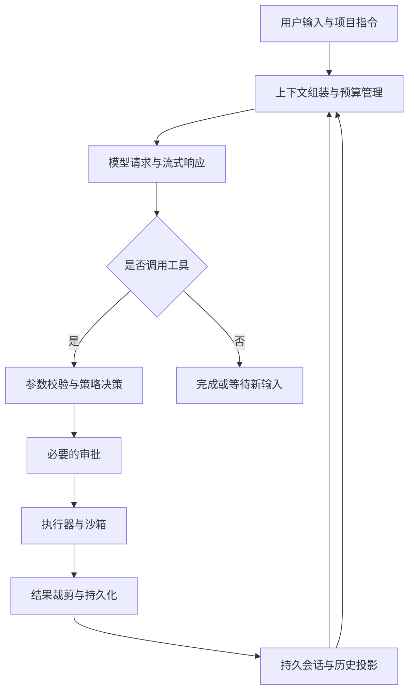

# 编码 Agent Harness 架构比较

调研日期：2026-11-01。方法：下载官方 GitHub 仓库，阅读架构文档及关键实现；随后根据用户补充，查找并核对了 Claude Code 2.1.88 的第三方 source map 源码存档，见第 9 节。属于静态源码分析，未运行产品或比较模型成功率、速度、费用。下文的实现事实附源码链接；“为何这样实现”除明确写入项目文档者外，是根据代码边界作出的工程解释，不代表作者原话。

## 1. 范围与版本

| 项目 | 阅读的提交 | 可见范围 |
|---|---|---|
| DeepSeek Harness | `ce7073d51254c26cd63b22a60835b8f948deb447` | 官方仓库，核心、插件、执行器及应用源码 |
| Codex | `67f0994b532b8740f14b5b738af7b7b2a915b1d6` | 官方开源 CLI、Rust 核心及 app-server；不等于完整云端产品后台 |
| Claude Code | `80c6959d28c4c30ecd14fc1cdf172f19d9adad81` | 官方仓库的 mods、类型契约、插件说明、配置示例；没有完整核心引擎源码 |
| OpenCode | `69269e4ebe309a08919b3c9be7948b9fd699c3a4` | Anomaly 官方仓库，核心、模型适配、服务端及客户端 |
| Gemini CLI | `6814e00d6b148c3a1d57244d5d7040f7c541009d` | Google 官方仓库的核心、CLI、调度和策略实现 |

DeepSeek Harness 与 DeepSeek-Coder、DeepSeek-V3 的模型训练/推理仓库是不同对象。本报告比较的是负责驱动模型完成工作的 harness，而非模型网络结构。

## 2. 共同骨架与真正的分歧

这只是共同抽象，不表示五个项目具有相同调用顺序。工程难点在于：中断后哪些动作已发生；哪些历史真正发给模型；工具参数被插件改写后审批是否仍有效；并发写操作是否冲突；上下文压缩后是否保留任务约束。

| 项目 | 最鲜明的结构选择 | 直接收益 | 主要代价 |
|---|---|---|---|
| DeepSeek Harness | 包括循环在内的能力插件化；日志驱动历史投影 | 可替换执行世界、模型和编排策略 | 组合顺序、生命周期和重放兼容性复杂 |
| Codex | Rust 核心、显式协议、集中工具编排与平台沙箱 | 执行生命周期与权限边界较明确 | 复杂核心改动和跨平台维护成本高 |
| Claude Code | 核心产品引擎搭配受控扩展；可见部分含分层函数 hooks | 工作流扩展与组织策略可以并存 | 核心不可完整审计，扩展受接口版本约束 |
| OpenCode | Effect 服务图、独立服务端、多模型适配 | 跨界面复用，方便模型和工作流组合 | 类型/运行时抽象学习成本与提供方差异处理成本 |
| Gemini CLI | 模型回合、调度状态机、声明式策略分离 | 工具审批状态清晰，组织策略易配置 | 调度、hook、策略与确认之间状态较多 |

## 3. DeepSeek Harness：将可替换性贯彻到循环本身

### 实现证据

- [架构说明](https://github.com/deepseek-ai/DeepSeek-Harness/blob/ce7073d51254c26cd63b22a60835b8f948deb447/docs/architecture.md)：基于 Cordis；模型适配器、工具注册表、会话日志和 agent loop 都是插件。profile 组合 bundle，随后叠加配置补丁；注册产生的 effects 在卸载时回收。
- [循环实现](https://github.com/deepseek-ai/DeepSeek-Harness/blob/ce7073d51254c26cd63b22a60835b8f948deb447/packages/core/agent-loop/src/agent.ts)：执行 `agent/pre-step`，绑定 `prepareCall()`，记录请求头，再从 Session 推导模型历史；工具执行后继续循环。失败或取消的流可记为 `assistant/attempt`，与进入模型历史的 `assistant/message` 区分。
- [会话服务](https://github.com/deepseek-ai/DeepSeek-Harness/blob/ce7073d51254c26cd63b22a60835b8f948deb447/packages/core/session/src/index.ts)：追加式事件日志是事实来源，`deriveMessages()` 生成模型历史。持久化由独立插件负责。
- [工具流水线](https://github.com/deepseek-ai/DeepSeek-Harness/blob/ce7073d51254c26cd63b22a60835b8f948deb447/packages/core/tools/src/pipeline.ts)：pre-execute 决策及必要审批后仍检查 guards，然后进入执行与 post-execute；最终结果会规范化。可重写的 hook 与只收紧权限的 guard 不是同一种机制。
- [PTC 执行器](https://github.com/deepseek-ai/DeepSeek-Harness/blob/ce7073d51254c26cd63b22a60835b8f948deb447/packages/core/tool-executor-ptc/README.md)：可以只暴露 `run_code`，让模型用程序调用生成的工具 SDK；中间结果默认不全部进入对话。嵌套调用仍通过工具流水线，并发安全调用可并行，独占调用构成屏障。

### 为什么这样实现

**把产品差异转化为组合配置。** 如果本地文件系统、子进程、远端执行器各自都有能力接口，把执行世界换成远端沙箱时，就不必复制一套 Bash、终端或 LSP 工具。插件化循环也允许实验不同编排策略，适合构建平台或开展 harness 研究。

**日志与模型历史分离，是为了同时支持审计和上下文变换。** 调试者需要看到失败尝试，模型却未必应该再次看到失败响应的半截内容。日志保留事实，投影决定模型看到什么；fork、resume、压缩和界面可以共享事实来源。

**PTC 是减少模型往返的一种方式。** 例如先搜索二十个文件、筛出三个结果再读取，可以在一次程序调用内完成，而不必每次都回到模型。它节约的是特定任务的往返和中间上下文，并不能保证所有任务更快或更便宜。

### 优劣判断

优点是实验空间大、能力边界清晰、跨产品委派也有统一接口。缺点是复杂度从一个中心循环转移到配置层次、插件依赖、事件顺序和卸载时序：仅看调用栈难以知道实际生效的行为，需同时检查 profile 和插件树。事件重放还要求投影语义及持久格式兼容。

插件的接口隔离不等于进程或权限隔离。项目自己的 [SAFETY.md](https://github.com/deepseek-ai/DeepSeek-Harness/blob/ce7073d51254c26cd63b22a60835b8f948deb447/SAFETY.md) 明确其为未经安全审计的 developer preview，因此不能仅凭架构设计宣称生产安全性。

## 4. Codex：围绕执行、权限与协议建立明确边界

### 实现证据

- [回合驱动](https://github.com/openai/codex/blob/67f0994b532b8740f14b5b738af7b7b2a915b1d6/codex-rs/core/src/session/turn.rs)：`run_turn()` 协调输入、压缩、模型请求和后续工具/用户输入；是否继续由模型后续工作与待处理输入共同决定。
- [工具路由](https://github.com/openai/codex/blob/67f0994b532b8740f14b5b738af7b7b2a915b1d6/codex-rs/core/src/tools/router.rs) 与 [工具编排](https://github.com/openai/codex/blob/67f0994b532b8740f14b5b738af7b7b2a915b1d6/codex-rs/core/src/tools/orchestrator.rs)：将工具分发和审批、沙箱选择、网络许可及拒绝后重试分开；文件说明明确，沙箱升级需要针对重试权限重新审查。
- [并发执行](https://github.com/openai/codex/blob/67f0994b532b8740f14b5b738af7b7b2a915b1d6/codex-rs/core/src/tools/parallel.rs)：读取工具的并发支持声明，使用共享/独占锁约束执行；持有发布该工具列表的 step context，避免延迟执行时误用后续上下文。
- [跨平台沙箱模块](https://github.com/openai/codex/blob/67f0994b532b8740f14b5b738af7b7b2a915b1d6/codex-rs/sandboxing/src/lib.rs)：包含 Linux、macOS、Windows 的相关实现与选择逻辑。
- [协议](https://github.com/openai/codex/blob/67f0994b532b8740f14b5b738af7b7b2a915b1d6/codex-rs/protocol/src/protocol.rs) 与 [app-server 契约](https://github.com/openai/codex/blob/67f0994b532b8740f14b5b738af7b7b2a915b1d6/codex-rs/app-server/README.md)：操作、事件、thread/turn/item 和审批具有显式结构；面向客户端的协议与内部模块分离。
- [压缩实现](https://github.com/openai/codex/blob/67f0994b532b8740f14b5b738af7b7b2a915b1d6/codex-rs/core/src/compact.rs) 和 [会话记录接口](https://github.com/openai/codex/blob/67f0994b532b8740f14b5b738af7b7b2a915b1d6/codex-rs/core/src/rollout.rs)：上下文压缩和持久记录是独立职责，而非直接删除 UI 中的聊天文本。

### 为什么这样实现

**审批应绑定到实际执行权限。** “允许在工作区内运行某命令”不能自动等同于“允许相同字符串在宿主机上运行”。集中编排器可以统一处理这种区别，减少不同工具各写一套审批逻辑造成的不一致。

**显式协议允许多个界面复用一套引擎。** 编辑器或终端需要增量展示输出、回答审批、恢复会话；结构化事件比解析终端文本更稳定。但协议字段和状态迁移也必须长期兼容。

**Rust 适合管理长寿命会话、并发任务与子进程资源。** 所有权和类型检查有助于约束实现错误，独立二进制也方便分发。这里不能推导出模型任务必然更快：网络推理、工具运行和排队可能占据主要耗时。

### 优劣判断

更适合作为需要明确权限边界、可追踪执行生命周期和跨平台集成的参考。代价是核心功能跨越协议、session、执行器、平台沙箱和测试，修改成本高。Codex 也有 hooks、MCP、扩展等机制；区别是关键执行生命周期仍由核心模块协调，不能将其概括为“没有插件的单体”。

## 5. Claude Code：可见源码展示的是受治理的扩展体系

### 证据边界

[仓库 README](https://github.com/anthropics/claude-code/blob/80c6959d28c4c30ecd14fc1cdf172f19d9adad81/README.md) 和 [许可证说明](https://github.com/anthropics/claude-code/blob/80c6959d28c4c30ecd14fc1cdf172f19d9adad81/LICENSE.md) 不能视为完整引擎开源的证明。本次没有看到可完整追踪模型请求、token 预算和主循环的核心实现，因此不声称审计了这些内部机制。

上述范围仅针对官方仓库。第三方保存的 2.1.88 历史核心源码已在第 9 节单独分析，不与当前官方 mods 版本混为一谈。也不能说“官方仓库完全没有源码”：该提交公开了有分析价值的内置 mods。

- [mods 说明](https://github.com/anthropics/claude-code/blob/80c6959d28c4c30ecd14fc1cdf172f19d9adad81/mods/README.md)：`register(on, options)` 注册函数 hooks，以 `($, e, next)` 组合事件；包含 `sec-default`、`diff`、`telemetry`、`agents-md`。
- [函数 hook 类型契约](https://github.com/anthropics/claude-code/blob/80c6959d28c4c30ecd14fc1cdf172f19d9adad81/mods/types/claude-code.d.ts)：该类 hook module 的运行环境没有直接 DOM、Node API，能力通过引擎接口获取；这是特定函数 hooks 的契约，不能套用到所有传统外部命令 hooks。
- [sec-default 设计及实现入口](https://github.com/anthropics/claude-code/blob/80c6959d28c4c30ecd14fc1cdf172f19d9adad81/mods/sec-default/README.md)：在满足管理条件时，保护组织的 hooks、指令和设置等，限制用户层插件对它们的改写；策略读取失败采取保守处理。文档也列出了适用条件、可配置例外和未覆盖范围。
- [传统 PreToolUse 示例](https://github.com/anthropics/claude-code/blob/80c6959d28c4c30ecd14fc1cdf172f19d9adad81/examples/hooks/bash_command_validator_example.py)：从标准输入读取工具调用，校验命令，退出码 2 阻止调用并把原因反馈给模型。
- [沙箱配置示例](https://github.com/anthropics/claude-code/blob/80c6959d28c4c30ecd14fc1cdf172f19d9adad81/examples/settings/settings-bash-sandbox.json)：分别配置启用沙箱、非沙箱命令许可和网络边界。它是示例，不能作为默认配置或底层隔离实现的证据。

### 为什么这样实现及其代价

插件需要足够强，才能介入提示词、工具、会话与界面；企业又必须保证普通用户安装的插件不能轻易抹除管理规则。分层 hooks 与受保护的策略位置，就是在解决“可扩展”与“不可由低信任层放宽”之间的冲突。

这种方式适合团队统一工作流、接入组织工具及复用产品能力。代价是 hook 顺序与来源层级本身成为复杂系统；企业策略的生效还受部署条件和配置影响。函数 hooks 标记为 early access，接口可能变化。闭源核心限制的是可审计和可替换程度，不足以证明其实现质量或安全性更差。

## 6. OpenCode：用服务图组织多模型、多界面的产品

### 实现证据

- [Agent 服务](https://github.com/anomalyco/opencode/blob/69269e4ebe309a08919b3c9be7948b9fd699c3a4/packages/core/src/agent.ts)：使用 Effect `Context.Service`、Layer 和状态服务；Agent 配置/选择独立于模型执行。
- [会话 runner 契约](https://github.com/anomalyco/opencode/blob/69269e4ebe309a08919b3c9be7948b9fd699c3a4/packages/core/src/session/runner/index.ts)：从已记录的 Session 历史排空可执行工作，并显式表示完成、位置迁移和重载后的 continuation。
- [模型 SDK 适配](https://github.com/anomalyco/opencode/blob/69269e4ebe309a08919b3c9be7948b9fd699c3a4/packages/core/src/aisdk.ts)：处理 SDK、模型选项及流式 SSE 等差异。不能仅凭旧版文章把当前实现当成早期单文件循环。
- [服务端组装](https://github.com/anomalyco/opencode/blob/69269e4ebe309a08919b3c9be7948b9fd699c3a4/packages/server/src/routes.ts)：路由组合会话、权限、工具与位置等服务；前端不直接拥有所有执行状态。
- [权限服务](https://github.com/anomalyco/opencode/blob/69269e4ebe309a08919b3c9be7948b9fd699c3a4/packages/core/src/permission.ts)：规则按 action/resource 匹配；`evaluate()` 选择最后一条匹配规则，未匹配时为 ask；服务另行处理缺失 Agent、无人值守等情形，不能只看单个匹配函数推导整个权限系统。
- [SQLite 服务](https://github.com/anomalyco/opencode/blob/69269e4ebe309a08919b3c9be7948b9fd699c3a4/packages/core/src/database/database.ts) 及 [压缩服务](https://github.com/anomalyco/opencode/blob/69269e4ebe309a08919b3c9be7948b9fd699c3a4/packages/core/src/session/compaction.ts)：支持状态持久化；压缩可以保留近期原文，并在接近阈值时后台预计算摘要。

### 为什么这样实现及其代价

**把界面与运行位置分离。** 终端、桌面或 Web 使用共同服务，能减少各自实现会话、审批和工具的重复。显式 continuation 也方便跨位置继续工作。

**用 Effect 管理依赖、错误与生命周期。** 相较大量隐式 Promise 和全局状态，服务依赖与错误通道更明确，测试也可以替换 Layer。代价是开发者需掌握额外的执行模型，阅读普通 TypeScript 的经验并不完全够用。

**多模型支持把成本放在适配层。** 更换提供方更方便，但工具 schema、流事件、usage 和上下文限制仍有差异。统一接口不代表同一套提示词和工具策略对所有模型都同样有效。

后台摘要减少临界时的等待，却可能产生未采用的摘要费用，还需确保摘要覆盖的历史与实际替换窗口一致。它是在延迟、成本和一致性之间做权衡。

## 7. Gemini CLI：把工具调用作为有状态作业调度

### 实现证据

- [GeminiClient](https://github.com/google-gemini/gemini-cli/blob/6814e00d6b148c3a1d57244d5d7040f7c541009d/packages/core/src/core/client.ts)：协调模型回合、压缩、输出遮蔽、循环检测与后续请求。
- [Turn](https://github.com/google-gemini/gemini-cli/blob/6814e00d6b148c3a1d57244d5d7040f7c541009d/packages/core/src/core/turn.ts)：把模型响应转为内容、工具请求、确认、错误和压缩等结构化事件。
- [Scheduler](https://github.com/google-gemini/gemini-cli/blob/6814e00d6b148c3a1d57244d5d7040f7c541009d/packages/core/src/scheduler/scheduler.ts)：独立组织校验、策略检查、确认、执行、取消及并发安全判断；等待确认是一种正式状态。
- [PolicyEngine](https://github.com/google-gemini/gemini-cli/blob/6814e00d6b148c3a1d57244d5d7040f7c541009d/packages/core/src/policy/policy-engine.ts)：规则按 priority 降序处理；结合参数、工作区及 shell 分析；默认未匹配决策区分交互与非交互。
- [策略优先级说明](https://github.com/google-gemini/gemini-cli/blob/6814e00d6b148c3a1d57244d5d7040f7c541009d/packages/core/src/policy/policies/read-only.toml)：说明 Admin、User、Workspace、Extension、Default 的分层优先级。

### 为什么这样实现及其代价

把“模型想调用工具”和“工具已获准执行”分开，使长时间等待人确认、批量工具调用、取消以及 headless 模式可以共用调度机制。声明式策略适合管理员维护规则，而非把组织要求散落在每个工具实现里。

代价是状态机更多，必须处理用户确认期间的取消、hook 修改参数后的检查顺序及批处理结果归并。策略引擎本身也不是 OS 沙箱；允许/拒绝决策与实际文件系统、网络隔离要分别验证。

该提交 README 对产品适用范围已有特别说明；本报告将它用作开源架构样本，不将历史版本的产品定位或额度规则当成当前事实。

## 8. 横向结论：为什么大家最终都在实现这些机制

### 8.1 模型不是状态机的可靠替代品

自然语言不能可靠表达“这次调用已开始但结果未知”，也不能保证模型正确记住取消、审批和工具副作用。Harness 必须用确定性代码维护这些事实，再给模型一个一致的视图。因此日志、状态机、取消传播和恢复不是外围功能，而是核心。

### 8.2 权限应有不可由普通扩展放宽的边界

DeepSeek 的 monotonic guards、Codex 的执行编排、Claude 的组织层保护和 Gemini 的策略优先级，是不同层次的机制，不能互相等同。但它们面对同一个问题：能重写输入或结果的插件，不能自然获得放宽权限的权力。审批还应匹配命令、目录、参数和实际执行环境。

### 8.3 并发需要语义，不能只使用 Promise.all

搜索两个文件通常可以并行，修改同一文件或同时操作 Git 索引则可能冲突。项目通过并发安全标记、独占屏障、锁或调度器约束这一点。工具声明准确与否仍然重要，调度框架不会自动证明工具无副作用。

### 8.4 上下文是预算，不是无限聊天记录

工具输出通常增长最快。裁剪、摘要、历史投影和后台压缩，都是在有限窗口里保存“继续任务需要什么”。日志可重放只能证明请求可还原，不能证明摘要保留了全部重要事实，更不能保证远端模型确定性复现。

### 8.5 不存在脱离目标的总排名

| 目标 | 优先借鉴 | 原因 |
|---|---|---|
| 研究编排、工具执行方式或远端运行时 | DeepSeek Harness | 循环和能力供应者可替换，PTC 与 native executor 可比较 |
| 深入研究审批、执行生命周期和平台隔离 | Codex | 编排器、协议、并发门控及沙箱模块都有源码 |
| 在现有商业产品上统一团队工作流 | Claude Code 的扩展体系 | 可复用 skills/hooks/mods；需接受核心不可完整审计 |
| 多模型、多客户端的开源产品开发 | OpenCode | 服务图、适配层、服务端与客户端分离 |
| 组织策略和工具调度器设计 | Gemini CLI | 调度状态与声明式策略分离明确 |

若要为本仓库构建新 harness，合理起点是：小而明确的执行循环、统一工具调用入口、可重建请求的会话记录、带取消语义的执行器，以及独立于可改写插件的权限约束。待需要第二种模型或第二种执行环境时，再验证抽象是否成立；不必一开始复制成熟项目的全部模块。

以上是结构与工程权衡判断，未构成安全审计或性能排名。若要判断“哪个实际更好”，还需在固定模型、工具权限和任务集下测成功率、人工干预、延迟、费用与恢复行为。

## 9. 补充：Claude Code 2.1.88 的第三方源码存档

### 9.1 找到的仓库与实际核对结果

| 仓库 | 本次用途 | 固定提交 |
|---|---|---|
| [ChinaSiro/claude-code-sourcemap](https://github.com/ChinaSiro/claude-code-sourcemap) | 包含 tgz、`package/cli.js.map` 和提取的 `restored-src` | `a8a678cb6244e6770e1e421767ff0987a1d95549` |
| [hangsman/claude-code-source](https://github.com/hangsman/claude-code-source) | 第二份源码存档，用于交叉核对及方便引用 | `d239e3f2c574b527f9f8691375525029edb3752d` |
| [alejandrobalderas/claude-code-from-source](https://github.com/alejandrobalderas/claude-code-from-source) | 找到的源码研究与讲解仓库；以下结论不以其讲解为主要证据 | 本节未对其内容作源码一致性验证 |

第一份存档 README 明确声明非官方、由 npm 包 source map 还原，不代表内部原始仓库结构。实际检查发现：

- 所附 package.json 标为 `2.1.88`；map 有 4,756 个 source 条目，均带字符串 `sourcesContent`。这是含依赖的 source 条目数量，不等于 4,756 个第一方模块。
- tgz 内的 `package/cli.js.map` 与存档中单独的 map 字节一致。
- 对 `query.ts`、`StreamingToolExecutor.ts`、`toolExecution.ts`、`Tool.ts`、`autoCompact.ts`、`runAgent.ts` 六个关键文件，map 内文本、`restored-src` 文件、另一份存档的对应文件完全一致。
- 官方 npm 的 `2.1.88` 元数据端点本次返回 404，因此未能用官方 registry integrity 独立认证所附 tgz。两个镜像也可能共享同一来源，其一致不能证明官方真实性。

因此可将其作为有内部一致性证据的历史实现样本来分析，但不能称为“官方开源”或当前版本；也不能认定它覆盖内部仓库、所有构建目标和测试。调研没有安装依赖或执行这些存档中的程序。

### 9.2 核心循环：异步生成器驱动的显式状态循环

[src/query.ts](https://github.com/hangsman/claude-code-source/blob/d239e3f2c574b527f9f8691375525029edb3752d/src/query.ts) 的 `query()` 委托给 `queryLoop()`，以 async generator 输出流事件、消息、请求开始、摘要和 tombstone 等。`queryLoop()` 使用 `while (true)` 与显式 `State`，保存历史、工具上下文、压缩追踪、恢复次数和 Stop hook 状态。

流程可概括为：准备历史 → 裁剪/压缩 → 模型流 → 收集并执行工具 → 记录结果 → 判断继续、恢复或终止。代码特别说明不完全依赖模型的 `stop_reason === 'tool_use'`，而根据实际接收到的 tool-use block 决定是否还有工具后续工作；无工具时还需考虑 Stop hook。

**为什么这样做：** async generator 允许终端或非交互消费者增量接收同一条执行过程，避免循环直接绑定 UI；显式状态支持恢复路径，不必依赖深层递归。实际工具块比服务端停止标签更贴近需要完成的工作。

**代价：** 主循环需要理解压缩、流回退、输出 token 恢复、工具执行和 hooks，中心协调复杂度高。它可集中优化产品体验，但更换整个执行语义时，比替换 DeepSeek 的 loop plugin 需要触碰更多内部约定。

### 9.3 工具执行：流式启动、受控并发、按接收顺序交付

[StreamingToolExecutor.ts](https://github.com/hangsman/claude-code-source/blob/d239e3f2c574b527f9f8691375525029edb3752d/src/services/tools/StreamingToolExecutor.ts) 使用 `queued / executing / completed / yielded` 状态：并发安全工具可以重叠执行，非并发安全工具独占；结果缓冲后按工具接收顺序交付，进度另行及时输出。该流式路径受 gate 控制，不表示所有部署默认启用。

[Tool.ts](https://github.com/hangsman/claude-code-source/blob/d239e3f2c574b527f9f8691375525029edb3752d/src/Tool.ts) 定义 schema、输入验证、权限检查及 `isConcurrencySafe(input)`；默认并发安全性为 false。[toolExecution.ts](https://github.com/hangsman/claude-code-source/blob/d239e3f2c574b527f9f8691375525029edb3752d/src/services/tools/toolExecution.ts) 则集中处理解析、验证、hooks、`canUseTool`、更新后的输入及最终 `tool.call()`。

**为什么这样做：** 已获得完整工具块后即可尽早启动，减少等待剩余模型流的延迟；统一管道减少工具遗漏权限流程的风险；稳定交付顺序有利于构造可预测的会话记录。

**代价：** 执行顺序与呈现顺序分离，需要额外缓冲及取消状态。若早先调用较慢，后续已完成结果可能等待交付。流式失败或模型回退更困难：抛弃消息结果不等于撤销已经发生的文件或命令副作用。

### 9.4 上下文：先轻量压缩，再完整摘要，并阻断失败重试风暴

`query.ts` 先处理 snip，再 microcompact，再评估 autocompact。[autoCompact.ts](https://github.com/hangsman/claude-code-source/blob/d239e3f2c574b527f9f8691375525029edb3752d/src/services/compact/autoCompact.ts) 按模型与 token 使用量判断阈值，并记录连续失败；达到限制后熔断自动压缩重试。microcompact 还有与缓存编辑有关的处理路径，不能一概当成普通摘要。

**为什么这样做：** 大量历史工具输出的保留价值递减，先做较轻的处理有机会减少完整摘要请求，保留较多原始任务信息；压缩连续失败时必须停止原地重试，否则没有任务进展也会持续消耗时间和费用。

**代价：** 多种历史变换有先后依赖，token 估计、缓存边界和可恢复的会话记录需要保持一致。摘要仍可能丢失约束；源码里存在策略不代表已经测得其在所有任务上的收益。

### 9.5 子代理：复用同一个 query，引入独立的任务上下文

[runAgent.ts](https://github.com/hangsman/claude-code-source/blob/d239e3f2c574b527f9f8691375525029edb3752d/src/tools/AgentTool/runAgent.ts) 选择子代理模型和工具集、创建 subagent context、处理取消与 transcript，并再次调用同一个 `query()`。同步与异步子代理对状态、控制器的共享方式不同，因此不能一概称为完全隔离。

**为什么这样做：** 保持一套经过处理的请求、工具和恢复语义；为探索或专项任务提供单独的上下文，减轻主对话的中间推理和输出负担。

**代价：** 子代理增加模型费用和父子协调成本；上下文独立并不自动带来文件系统独立，更不等于 VM 或容器隔离。共享工作目录时仍有并发写冲突。

### 9.6 修正后的横向定位

对这份历史源码，更具体的判断是：**Claude Code 用一个协调能力较强的中心 query loop，配合统一工具管道、流式并发执行和分级上下文处理，优化编码工作流的连续性。** 这与 DeepSeek 把整个循环纳入插件组合的方向不同，也与 Codex 围绕 Rust 核心、协议和执行编排的组织方式不同。

这不是“插件少/多”的简单排名：中心协调有利于把恢复、延迟和交互细节一起优化，但扩展执行语义更依赖引擎内部约定；插件式循环方便替换策略，却需要额外治理组合顺序和生命周期。第 5 节较新官方 mods 展示了扩展体系的另一部分，不能据此倒推 2.1.88 已具有完全相同的机制。
