# Agent Harness 架构分析

基于官方源码与注明来源的历史存档，比较 **DeepSeek Harness、Codex、Claude Code、OpenCode、Gemini CLI** 的架构、关键能力与工程取舍。

调研日期：2026-11-01。静态源码分析，未进行模型效果或性能排名。

## 从这里阅读

| 内容 | 你会看到什么 |
|---|---|
| [应用架构图](docs/ARCHITECTURE_DIAGRAMS.zh-CN.md) | 一张共同骨架图、五张应用架构图；SVG 与 Mermaid 源码 |
| [关键能力对比](docs/CAPABILITIES.zh-CN.md) | 执行与上下文、扩展与权限、收益与代价、选型参考 |
| [完整调研报告](ARCHITECTURE_ANALYSIS.zh-CN.md) | 实现细节、为什么这样设计、固定提交的源码链接 |

## 架构总览

这是共同抽象，各项目的真实分层和调用顺序见[应用架构图](docs/ARCHITECTURE_DIAGRAMS.zh-CN.md)。

## 五种设计方向

| 应用 | 核心选择 | 值得借鉴的重点 |
|---|---|---|
| DeepSeek Harness | 连循环也可替换的插件组合 | 能力接口、日志投影、程序化工具执行 |
| Codex | Rust 核心与集中执行编排 | 协议、审批、并发门控、平台沙箱 |
| Claude Code 2.1.88 | 中心 query 循环与流式工具执行 | 分级压缩、恢复、子代理复用 |
| OpenCode | Effect 服务图与多模型适配 | 多客户端复用、依赖与生命周期管理 |
| Gemini CLI | 回合、调度、策略分离 | 工具状态机、确认与声明式规则 |

## 阅读边界

- Claude Code 核心图来自第三方保存的 **2.1.88 历史源码**，不能代表最新版；报告另行分析了较新官方仓库的 mods。
- 已核对两份 Claude Code 存档的六个关键文件与所附 source map 一致；尚未完成官方发布包来源认证。
- 图和表表达本次阅读的机制；“未检查”不等于“不支持”，权限配置不等于操作系统隔离。
- 源码提交、出处和方法详见[完整报告](ARCHITECTURE_ANALYSIS.zh-CN.md)。
