# 应用架构图

[返回首页](../README.md) · [关键能力对比](CAPABILITIES.zh-CN.md) · [完整报告](../ARCHITECTURE_ANALYSIS.zh-CN.md)

调研日期：2026-11-01。每张图只保留主要职责与关键回路，未穷举模块。**架构图不是完整调用追踪，也不是安全边界证明。**

颜色统一：蓝色为入口，绿色为执行核心，橙色为权限与策略，紫色为持久状态。实线通常表示主路径，虚线的含义在每图说明中列明。

图以 SVG 展示，便于直接在 GitHub 查看和放大；每图附 Mermaid 源码，可在支持 Mermaid 的编辑器中修改。

## 0. 共同执行骨架


共同抽象，不代表每个项目的精确调用顺序。关键职责是上下文、模型、工具权限、执行及状态回写。

为什么需要这些层：模型负责选择动作，确定性程序负责记录事实、控制权限和恢复执行。

[放大 SVG](diagrams/overview.svg) · [Mermaid 源文件](diagrams/overview.mmd)

查看 Mermaid 源码

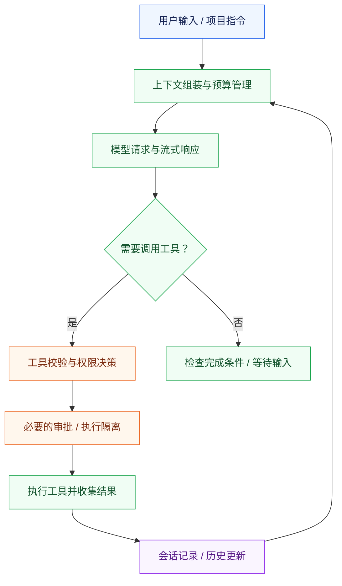

## 1. DeepSeek Harness：由插件组合整套运行时


图中实线为主要调用或数据路径；虚线为插件装配关系。核心组件本身也是插件。

为什么这样实现：替换运行环境或编排策略时，尽量更换能力供应者，而不是复制产品。代价是配置顺序、生命周期和事件语义更复杂。

[放大 SVG](diagrams/deepseek.svg) · [Mermaid 源文件](diagrams/deepseek.mmd)

查看 Mermaid 源码

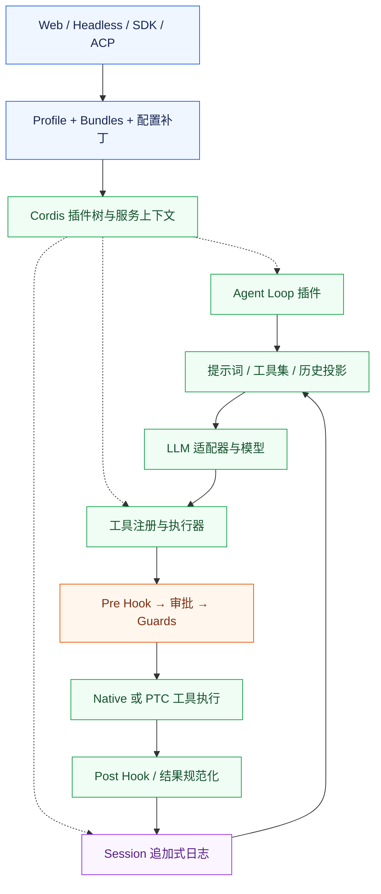

## 2. Codex：核心引擎协调协议、审批与执行


实线展示主要执行路径；虚线表示恢复及向客户端反馈事件。图中的协议入口是概念归纳，各客户端的具体入口不同。

为什么这样实现：把模型请求与实际执行权限分开，集中处理审批和沙箱升级，并支持多个界面复用引擎。代价是核心及跨平台维护成本较高。

[放大 SVG](diagrams/codex.svg) · [Mermaid 源文件](diagrams/codex.mmd)

查看 Mermaid 源码

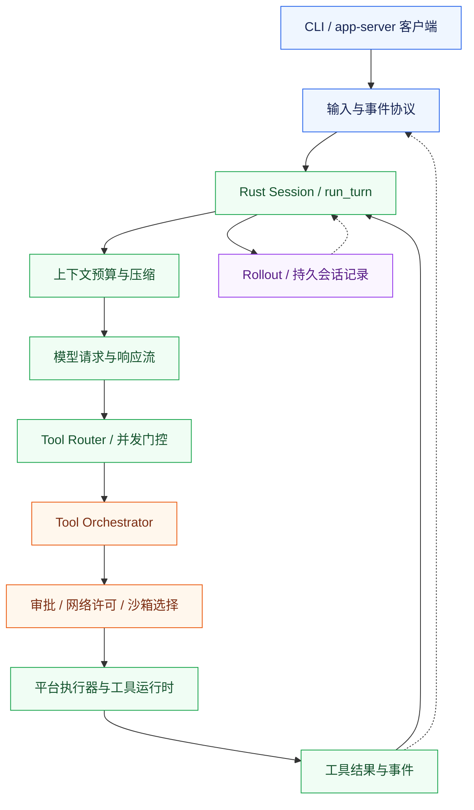

## 3. Claude Code 2.1.88：中心循环与流式工具执行


仅代表第三方保存的 2.1.88 历史实现。流式工具执行受 gate 控制。虚线表示可选子代理及记录路径，不表示 OS 隔离。

为什么这样实现：一套 query 循环统一协调流、工具、压缩和恢复，子代理复用同一执行语义。代价是中心职责较多，流回退不能自动撤销已发生的工具副作用。

[放大 SVG](diagrams/claude-code.svg) · [Mermaid 源文件](diagrams/claude-code.mmd)

查看 Mermaid 源码

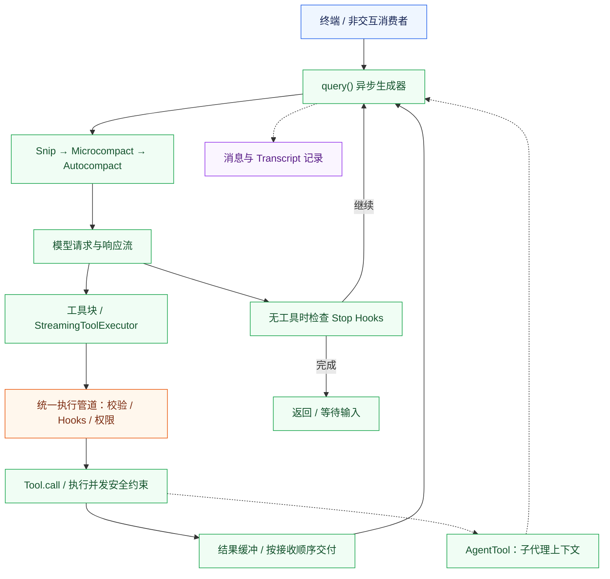

## 4. OpenCode：服务图、多模型与多客户端


图按职责分层，不把 Hooks 与权限画成严格时序。虚线表示服务端向客户端提供状态。

为什么这样实现：用 Effect 服务依赖和生命周期管理，复用模型、会话与权限能力。代价是抽象学习成本和模型差异适配成本。

[放大 SVG](diagrams/opencode.svg) · [Mermaid 源文件](diagrams/opencode.mmd)

查看 Mermaid 源码

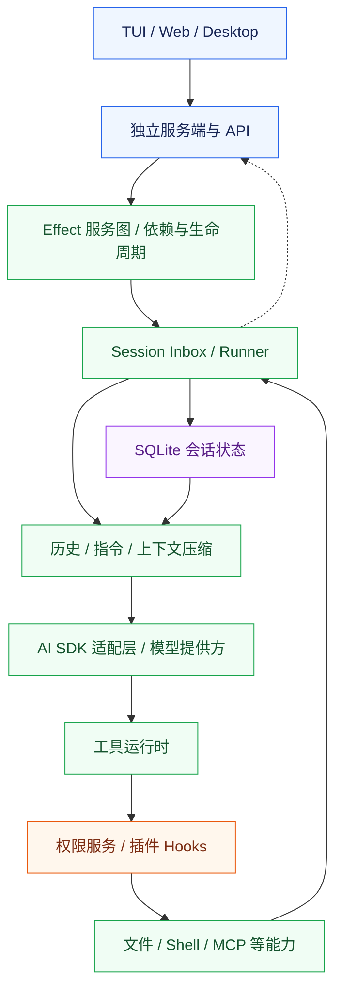

## 5. Gemini CLI：回合、工具调度与策略分离


实线表示主路径；虚线表示辅助服务。策略拒绝、错误恢复等分支为保持可读性未展开。

为什么这样实现：让等待确认、取消和并发工具都成为可管理的状态；策略单独配置。代价是状态机与 Hook 交互更复杂。

[放大 SVG](diagrams/gemini-cli.svg) · [Mermaid 源文件](diagrams/gemini-cli.mmd)

查看 Mermaid 源码

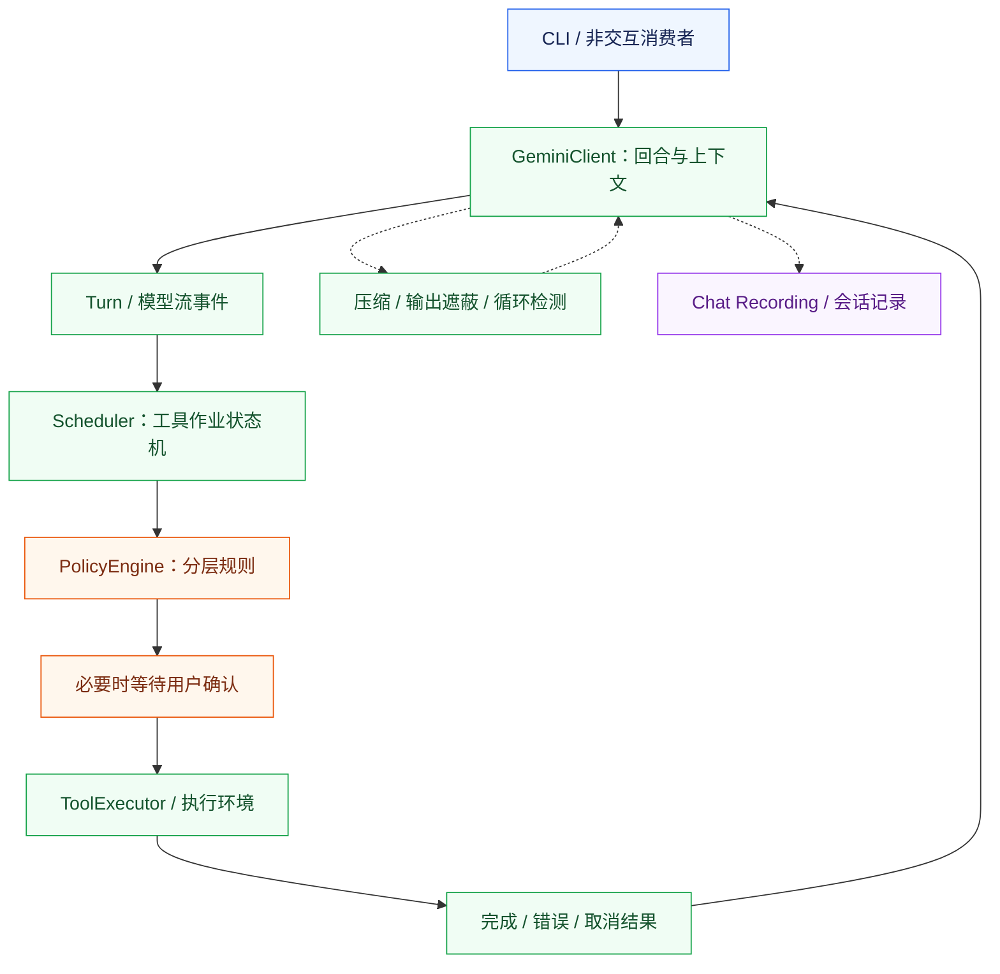

## 证据与版本

各图固定源码提交及直接证据见[完整报告](../ARCHITECTURE_ANALYSIS.zh-CN.md)。Claude Code 的历史核心图与报告中的较新官方 mods 分开处理，不将不同版本拼接为一套当前实现。

重新生成 SVG：使用 `@mermaid-js/mermaid-cli` 对 `docs/diagrams/*.mmd` 逐一渲染。本次工具版本记录于 [渲染记录](diagrams/RENDERING.md)。
